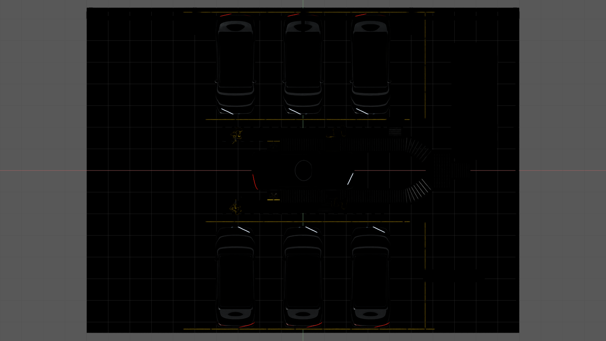
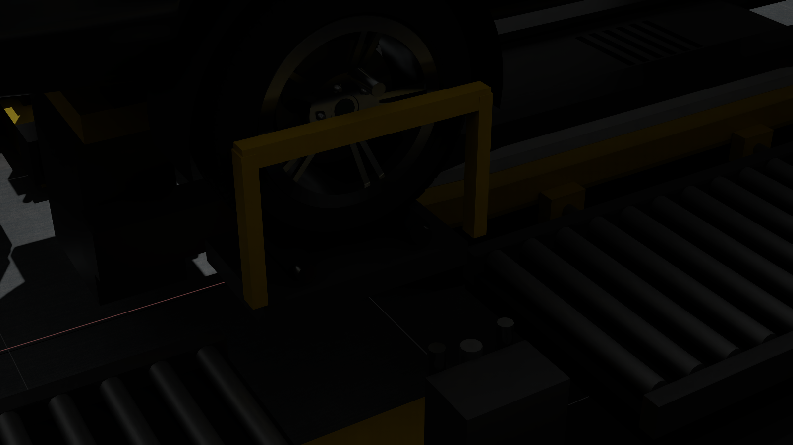

# CN7 휠 조립 셀 — 작업 기록 (2026-11-25)

목표: 금요일(11/27)까지 **실제 PhysX 물리로 동작하는** 자동차 휠 체결 맵 완성.
참고 배치도(`/home/rokey/project/image.png`)와 같은 구성입니다. 트럭은 이번 범위에서 제외합니다.

## 1. 현재 맵 상태

| 오버뷰 (40 s) | 조립 셀 (45 s) |
|---|---|
|  |  |

| 탑뷰 (40 s, 조명 부족) | 휠 디테일 (60 s) | 허브 디테일 (20 s) |
|---|---|---|
|  |  |  |

배치도와 대응하는 요소:

| 배치도 | 맵 |
|---|---|
| 타이어 공급 라인 좌/우 | `factory/conveyor` (분기 S자 컨베이어 + 축별 이송) |
| 로봇팔 (타이어 장착) | 두산 H2515 × 2 (`LeftMount`, `RightMount`) |
| 로봇팔 (스크류 체결) | 두산 M1509 × 2 (`LeftFasten`, `RightFasten`) |
| 로봇팔 레인 좌/우 | `factory/robot_rails` |
| AMR (자동 이송) | KUKA KMP1500급 AMR + 리프트 |
| 대기구역 / 출고구역 | `factory/vehicle_buffers` |

이미지 다시 찍기: `~/isaacsim/python.sh map/wheel_cell/capture.py map/scene/wheel_cell.usda map/docs/images Overview@40 ...`

## 2. 장면 분할 구조 (USD 레이어)

빌드 결과를 한 파일(18 MB)이 아닌 **루트 1개 + 영역별 서브레이어 14개**로 만듭니다.
Isaac Sim에서 `map/scene/wheel_cell.usda`를 열면 Layer 패널에서 영역별로 켜고 끄거나 편집할 수 있습니다.

```
map/scene/
├── wheel_cell.usda              # 루트: 스테이지 메타데이터 + 서브레이어 목록
├── overrides/*.usda             # 손으로 편집하는 레이어 (빌드가 덮어쓰지 않음, 가장 강함)
├── concrete.png
├── shared/asset_library.usdc    # 로봇 링크·휠·차체 공용 메시 (17 MB)
├── shared/materials.usdc        # /Looks 재질
├── environment/lighting_cameras.usdc
├── factory/
│   ├── building.usdc  floor.usdc  conveyor.usdc  robot_rails.usdc
│   ├── safety.usdc    vehicle_buffers.usdc  truck.usdc
└── orders/CN7_001.usdc … CN7_004.usdc   # 차량별 공정(AMR·로봇·휠 키프레임)
```

- 분할 코드: `map/wheel_cell/split_scene.py`. `build.py`가 빌드 마지막에 자동으로 호출합니다.
- 검증: 분할 전 단일 파일과 비교해 프림 5,100개, 속성 81,009개, 관계와 타임샘플이 모두 일치했습니다. 차이는 텍스처 경로 1개뿐인데, 복사한 같은 파일을 가리킵니다.
- 이제 `launch.py`, `check_physics.py`가 기본으로 `map/scene/wheel_cell.usda`를 엽니다.
- 나눠서 작업하는 방법은 [`map/scene/README.md`](../scene/README.md)를 보세요.
- 용어는 [`GLOSSARY.md`](GLOSSARY.md)로 통일합니다.
- 공정 시나리오와 현재 구현의 차이는 [`PROCESS_SCENARIO.md`](PROCESS_SCENARIO.md)를 보세요.

## 3. 변경 사항

| 파일 | 내용 |
|---|---|
| `visuals.py` | `isaacpjt` 원본 에셋이 없을 때 `assets/tire_example.usda`와 `assets/d455_tool.usda`를 대신 씁니다. |
| `assets/tire_example.usda`, `assets/d455_tool.usda` | 기존 빌드 결과에서 복원한 메시입니다. 다시 빌드한 결과가 원본과 일치했습니다(오차 0). |
| `physics.py` 기립 지그 | 두 턱을 **랙·피니언 조인트로 동기화**했습니다(SCHUNK PHL 방식). |
| `physics.py` 스핀들 | 인계 때 휠을 **삽입 축 중심에 맞춰** 고정합니다. |
| `physics.py` 로봇 | 타이어 장착 로봇이 시계 대신 **공정 상태에 맞춰** 움직입니다. 대기 자세에서 기다렸다가 삽입이 끝나면 안전 자세로 빠집니다. |
| `conveyor.py` 지그 대기 | 인계 후 지그를 세운 채로 축 쪽으로 물려서 낮추고, 턱을 닫습니다. |
| `split_scene.py`, `build.py` | 장면을 레이어로 분할합니다. |
| `capture.py` | 문서용 스크린샷을 렌더링합니다. |
| 디버그 | `CELL_DEBUG=1`, `CELL_DEBUG_TIP=<FL..>`, `CELL_DEBUG_JAW=<FL..>`를 켤 때만 진단 로그를 출력합니다. |

## 4. 에러 기록 (발생 순서)

모든 물리 결과는 `./map/wheel_cell/check_physics.sh --seed 42` 기준입니다.

### E1. 빌드 실패: 에셋 파일 없음 — ✅ 해결
```
FileNotFoundError: Set --asset-root to isaacpjt. Missing:
  ~/cobot3_ws/isaacpjt/M0609/robot/m0609_rg2_d455_edit.usd
  ~/cobot3_ws/isaacpjt/Factory/CN7/tire_example/tire_example.usd
```
- **원인:** 원래 빌드하던 PC의 에셋이 이 PC에는 없습니다(`Factory/` 폴더 자체가 없음).
- **조치:** 기존 `wheel_cell.usdc`에 베이크된 메시를 복원해 `assets/`에 넣고, 원본이 없으면 이 파일을 쓰게 했습니다.

### E2. 4개 스테이션 모두 `grip_slip` (기립 중 46 mm 미끄러짐) — ✅ 해결
```
FL/FR/RL/RR: result=grip_slip, grip_slip_mm≈46, tip_handoff=false
```
- **원인:** 패드 마찰 문제가 아니었습니다. 두 턱 드라이브가 650 N 한계에서 서로 밀고 있어서 **턱 쌍의 중심을 잡아주는 힘이 없었습니다.** 지그를 기울이면 휠과 턱이 한 덩어리로 턱 축을 따라 −40 mm에서 +42 mm까지 흘렀습니다(디버그 로그 `d=(0,-40.4,0)`).
- **조치:** `PhysxPhysicsRackAndPinionJoint`로 두 턱을 피니언 하나에 묶었습니다.
- **결과:** 미끄러짐이 **46 mm에서 0.5 mm**로 줄었고, 4개 스테이션 모두 기립과 인계에 성공했습니다.

### E3. 타이어 장착 로봇이 휠에 충돌 (`equipment_contact`) — ✅ 해결
```
CONTACTDBG RightMount/Link_6/GuideGripper  ↔  FR/Wheel/Web_32   (침투 1.0 mm)
```
- **원인:** 로봇 키프레임은 리플레이용이라 "로봇이 휠을 들고 허브까지 간다"는 동작이에요. 라이브에서는 셔틀 프레스가 휠을 밀어 넣습니다. 그래서 정해진 시간에 움직인 로봇 그리퍼가 공급 위치에 있던 휠에 먼저 박혔습니다.
- **조치:** 타이어 장착 로봇은 휠 바깥 대기 자세에서 기다립니다. 해당 축 삽입이 끝나면 관절 공간에서 2초 동안 안전 자세로 빠져나옵니다(`Robot.advance`).

### E4. 로봇이 대기 중인 기립 지그를 밀어 삽입 경로를 막음 — ✅ 해결
```
INSERTDBG FL ... /World/Live/FL/TipJawA/RubberPad   (삽입 내내 접촉)
JAWDBG aligned 26.75→28.75s  tool x 1.82 → 1.41
```
- **원인:** 지그가 수평 자세로 x 1.82에서 대기했습니다. AMR이 도킹하자 타이어 장착 로봇 레일 캐리지가 x 1.89로 들어오며 지그를 밀었고, 턱 빔이 허브와 휠 사이에 끼었습니다.
- **조치:** 지그를 세운 채로 축 쪽(x −0.07)으로 물리고, 0.2 m 낮춘 뒤 턱을 닫습니다.

### E5. 스터드 걸림 (`jammed`, 허브 30 mm 앞) — ✅ 해결
```
CENTERDBG FL gap 29.9 mm  center_mm 1.118  → Stud_0..4 접촉
```
- **원인:** 인계 때 스핀들이 휠의 실제 위치를 그대로 고정했습니다. 인계 기준이 6 mm 오차까지 허용하기 때문이에요. 그래서 휠이 허브 축에서 1.1 mm 어긋났고, 스터드와 구멍 사이 여유 0.7 mm를 넘어 스터드 끝에서 걸렸습니다.
- **조치:** 스핀들이 휠을 삽입 축 중심에 고정합니다(실제 스핀들의 파일럿 센터링과 같은 방식).
- **결과:** 중심 오차가 **1.1 mm에서 0.28 mm**로 줄었습니다. FL은 스터드를 통과해 **장착면 3.9 mm 앞**까지 들어갔고, RL은 11.9 mm 앞에서 멈췄습니다.

### E6. 시도했다가 되돌린 것: 지그를 더 낮게 대기 — ↩️ 되돌림
- 지그를 레일 안쪽(y 1.35)으로 넣고 0.28 m 낮추면, 셔틀 크래들(포크와 롤러)이 지그 턱 패드에 걸려 셔틀이 움직이지 못했습니다.
```
SHUTTLEDBG FL/Shuttle/Cradle/Visual/Fork ↔ FL/TipJawB/RubberPad
```
- E4의 대기 위치로 되돌렸습니다.

### E7. 마지막 수 mm에서 안착하지 못함 (결합구역 문제 1) — ✅ 해결 (2026-11-25)
하나씩 고치고 테스트한 순서입니다.

| # | 원인 (진단 근거) | 변경 하나 | 결과 |
|---|---|---|---|
| 7-1 | FL이 막힌 게 아니라 파일럿 구간에서 천천히 들어가는 중에 8초 제한에 걸림 (마지막 1초 동안 5.8 → 3.9 mm) | `INSERT_TIMEOUT` 8 → 12초 | 2.84 mm에서 **완전 정지**. 진짜 원인이 드러남 (유지) |
| 7-2 | 도킹한 차체가 고무 패드에 0.3 mm 내려앉아, 고정 스핀들 축과 허브 축이 **0.28 mm** 어긋남. 보어–파일럿 여유는 0.05 mm라 마찰로 정지 | **플로팅 스핀들**: 반경 ±1.5 mm, 4×10⁵ N/m, 휠 무게 보정 | FL·RL **seated** (중심 오차 0.27 → 0.05 mm). 대신 FR 정렬 실패가 새로 생김 |
| 7-3 | 플로트 때문에 FR 타이어가 크래들 받침 롤러(고정 충돌체, 고무 마찰 0.82)에 닿아 회전이 −0.6°에서 묶임 | 받침 롤러에 아이들러 마찰 0.02 (`IdlerRoller`) | 4개 스테이션 모두 정렬 성공 |
| 7-4 | seed 123에서 FL이 12 mm 앞에서 정지. 32각형 타이어 충돌 형상이 각도에 따라 롤러에 최대 1.5 mm 다르게 닿아 휠을 0.9 mm 들어 올림 | 크래들 롤러 틈 `CRADLE_CLEARANCE` 2.5 mm | seed 42 / 7 / 123 모두 FL·RL **seated** |

- 고장 검출 회귀 시험 `--jam`(FL 지그 2 mm 오차): FL은 기대대로 `jammed`가 나옵니다.

### E8. 고장 뒤 다른 스테이션이 어긋난 차체에 삽입 (인터록) — ⚠️ 부분 해결 (2026-11-25)
- **증상:** `--jam`에서 FL이 막히면 FL 프레스가 차체를 밀어 `dock_lost`가 나고, 그 뒤 RL이 허브가 12.4 mm 어긋난 채 삽입을 시작해 실패했어요.
- **변경 (유지):** `INTERLOCK_FAULTS = {jammed, dock_lost}`. 어느 스테이션이든 이 상태가 되면, 아직 삽입 전인 스테이션은 새 종료 상태 `interlocked`로 멈춰요. 로봇 간섭(`interference`)은 해당 쪽 로봇만 멈추는 별도 안전 정지라 조건에서 뺐어요.
- **결과:** 고장이 판정된 뒤에는 RL이 `interlocked`로 멈춰요. 정상 실행(seed 42)에서는 FL·RL `seated`로 변화가 없어요.
- **한계:** FL 막힘은 12초 시간 제한이 지나야 판정돼서, 그 전에 RL이 삽입을 시작하면 인터록이 늦어요.
- **되돌린 시도:** "1.5초 동안 0.5 mm도 들어가지 않으면 `jammed`"로 빨리 판정하게 했더니, 정상 삽입(seed 7)에서 파일럿 입구의 중심 맞춤 대기까지 고장으로 판정했어요. 그래서 되돌렸어요.

### E9. 파일럿 진입 불안정 (실행마다 결과가 다름) — 🔍 진행 중
- 같은 seed 7로 돌려도 한 번은 FL·RL `seated`, 다른 한 번은 12~14 mm에서 `jammed`였어요. CPU PhysX 멀티스레드 계산 때문에 실행마다 미세하게 달라져요.
- **원인 추정:** 휠 센터 구멍과 허브 파일럿 사이 반경 여유가 0.05 mm인데, 모델의 파일럿 끝은 모따기 없는 직각 원통이에요. 조금만 어긋나도 구멍 테두리가 파일럿 끝 모서리에 걸려요.
- **시도 1 (되돌림):** 파일럿 끝에 1.5 mm × 45° 모따기를 넣었어요. seed 42와 seed 7(1회차)은 seated였지만, seed 7(2회차)은 FL이 12.8 mm에서 `jammed`였어요. seed 123에서는 PhysX 오류 `PxD6Joint::setDrivePosition: pose invalid`와 함께 FL이 허브를 51 mm 관통하고 RL이 `dock_lost`가 됐어요. 나아졌다고 볼 수 없어서 되돌렸어요.
- **새로 찾은 버그:** 정렬 중 휠 각도(`Station.step`의 `angle`)가 가끔 `nan`이 돼요(FR 디버그 로그). 이 값이 스핀들 목표로 들어가면 위 PhysX 오류가 나고 시뮬레이션이 무너져요. 다음 작업 1순위예요.

## 5. 현재 결과 (2026-11-25, E8 반영 후)

| 실행 | FL | RL | FR / RR |
|---|---|---|---|
| seed 42 | ✅ seated | ✅ seated | `interference` |
| seed 7 (실행마다 다름) | seated 또는 `jammed` 12~14 mm | seated 또는 `jammed` 11 mm | `interference` |
| seed 123 | ✅ seated | ✅ seated | `interference` |
| `--jam` (seed 42) | `jammed`(통과) 또는 `dock_lost`(실패) | `interlocked` 또는 `jammed` | `interference` |

## 6. 남은 문제 (다음 작업, 하나씩)

1. **휠 각도 NaN 버그 (E9):** 스핀들 목표가 NaN이 되어 시뮬레이션이 무너져요. 먼저 고쳐야 다른 결과를 믿을 수 있어요.
2. **파일럿 진입 불안정 (E9):** 모따기 시도 1은 실패했어요. 시도 횟수 1/3.
3. **오른쪽 타이어 장착 로봇과 지그 간섭 (FR, RR):** RightMount Link_5가 세워 둔 FR 지그 빔(z 약 1.0)에 1~2 mm 닿아 안전 정지해요. 크래들 간섭(E6)도 함께 피해야 해요.
4. **인터록 조기 감지 (E8 한계):** 막힌 프레스가 차체를 미는 것을 시간 제한보다 빨리 알아내야 해요. 진행 정체만으로는 정상 삽입과 구분할 수 없었어요.
5. **볼트 체결:** 볼트 체결 로봇은 라이브에서 대기만 해요(`sample ≤ 54 s`). 너트 체결은 키프레임 시연에만 있어요.
6. **탑뷰와 세부 카메라 조명**
7. 디버그 로그 코드(`CELL_DEBUG*`)는 환경변수로만 켜지므로 그대로 두었어요.

## 7. 실행 방법

```bash
cd ~/project
./map/wheel_cell/build.sh                         # 빌드 + 레이어 분할
./map/wheel_cell/run.sh --assembly --seed 42      # 라이브 물리 (창에서 Play)
./map/wheel_cell/run.sh --replay                  # 키프레임 시연
CELL_DEBUG=1 ./map/wheel_cell/check_physics.sh --seed 42   # 헤드리스 검증 + 진단 로그
```
